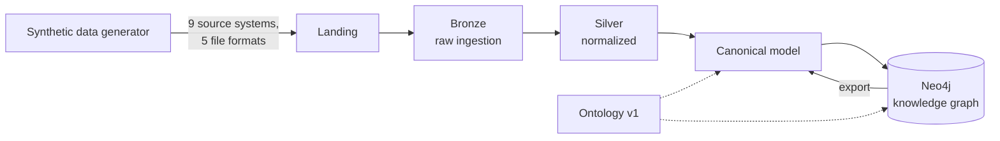

# OntologySim

A proof of concept for a common problem in automotive engineering: the data about one vehicle function is spread across many tools, in different formats, with inconsistent IDs. Requirements live in one system, test results in another, logs in a third, and defects in a spreadsheet.

OntologySim generates realistic synthetic data for that situation, cleans it in a Databricks pipeline, and connects it in a Neo4j knowledge graph, so a question like *"which requirements are affected by this defect, and which test runs showed it?"* becomes a single graph query.

> All data is synthetic. No real vehicle or company data is used.

## How it works



### 1. Synthetic data generator

The generator first builds a consistent **ground truth** (ECUs, components, requirements, test cases, test runs, defects), then projects it into the separate source systems an engineering team would actually work with:

| Source | Format |
|---|---|
| Requirements, system architecture | XML |
| Test management, traceability links | CSV |
| Test executions, ConMod runtime logs | JSONL |
| HCP3 / HCP5 ECU logs | text logs |
| Defects | Excel |

To make the data behave like real data, it is **deliberately made messy**: missing links, duplicate records, missing fields, malformed log lines, stale IDs, references hidden in free text, and clock drift between ECUs. Because the ground truth is kept, you can measure how much of it the pipeline recovers.

Failures come from **8 scenarios**, such as Bluetooth reconnection after wake-up, network handover for online services, charging session failures, and software update incompatibilities. Generation is deterministic (seeded) and streams output in chunks. Profiles range from `smoke` (about 120k log events) to `medium` (about 38M log events and 160k test executions).

### 2. Databricks pipeline

Notebooks in [`databricks/`](databricks) implement a medallion architecture:

- **Bronze:** ingests each source as-is, with control checks per generation.
- **Silver:** normalizes structure and values per source.
- **Canonical:** maps all sources onto one shared data model.
- **Semantic quality:** checks the canonical data against the ontology.

### 3. Ontology and knowledge graph

[`ontology/v1`](ontology/v1) defines 7 entities (ECU, Component, Requirement, TestCase, TestExecution, Incident, Defect) and their relationships, for example `ECU -HOSTS-> Component` and `Defect -FOUND_DURING-> TestExecution`. A separate mapping file turns the ontology into a Neo4j schema.

Scripts in [`scripts/`](scripts) load the canonical tables into Neo4j, validate the graph, and export it back to Databricks.

## Getting started

Requirements: Python 3.12, [uv](https://docs.astral.sh/uv/), Docker, and a Databricks workspace for the pipeline part.

```bash
uv sync --extra dev
cp .env.example .env          # fill in Neo4j and Databricks settings
docker compose up -d          # local Neo4j on localhost:7474

# generate data (pick the profile in config/generator.toml)
uv run python -m ontologysim.generator --config config/generator.toml

uv run pytest
```

## Project structure

```text
src/ontologysim/
  generator/     scenarios, ground truth, source projections, data corruption, writers
  ingestion/     manifest and validation for ingested generations
  neo4j/         graph connection and loader
databricks/      Bronze, Silver, canonical and quality notebooks
ontology/v1/     ontology and Neo4j mapping
scripts/         Neo4j load, validation and Databricks export
tests/           generator and ingestion tests
```

## Tech stack

Python · Databricks · PySpark · Delta Lake · Neo4j / Cypher · Docker · uv · pytest
